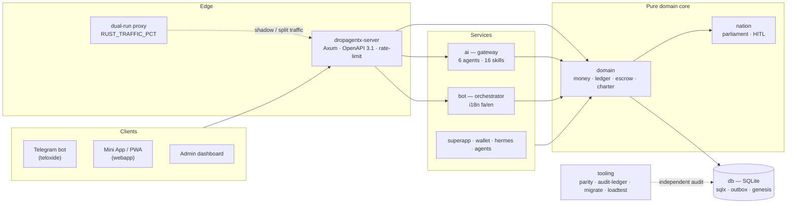
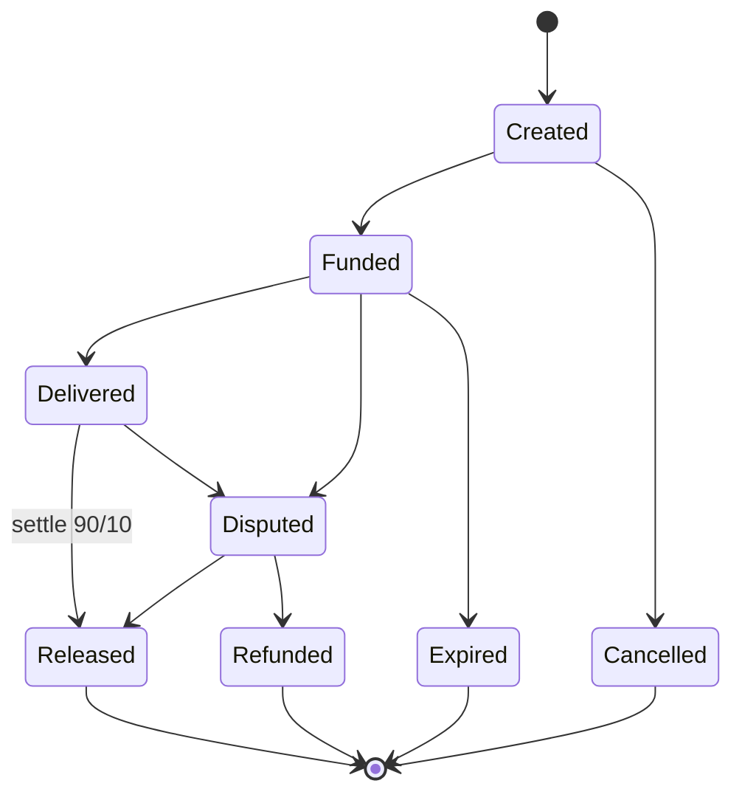

<div align="center">

# DropAgentX **pro**

**A Telegram-native marketplace with its own sovereign currency, escrow court, AI workforce — now running on a single, audited Rust core.**

[](https://www.rust-lang.org/)
[](#quality-gates)
[](#quality-gates)
[](#the-frozen-api-contract)
[](#the-din-economy)
[](#quality-gates)
[](#license)

[Quickstart](#quickstart) · [Architecture](#architecture) · [The Din economy](#the-din-economy) · [Quality gates](#quality-gates) · [Deploy on Railway](#deployment) · [مستندات فارسی](README-fa.md)

</div>

---

## Why this repository exists

DropAgentX grew through three generations — a Python bot (**gen 1, HermesA**), a TypeScript
super-app (**gen 2**), and a TypeScript domain-first engine (**gen 3, Agent-One**) — spread across
nine repositories. Versioned business logic in three languages is a liability, so the whole empire
was consolidated **into one Rust workspace** following a 20-week, 9-phase migration plan
([ADR-009](rust/docs/adr/ADR-009-Rust-Migration-Roadmap.html)).

The migration is **complete and signed off** (`v10/10` — [sign-off act](rust/docs/final/SIGN-OFF.md)):
all 9 phases delivered as 10 audited releases, a 2-week dual-run/cut-over procedure with a
43-scenario byte-exact parity gate, an independent ledger audit, and a one-command rollback
contract. TypeScript now sits in warm standby; Rust is the primary engine.

> **One workspace. One frozen contract. One currency. Zero behavioral drift.**

## Highlights

| | |
|---|---|
| **Core** | 13-crate Cargo workspace, `#![forbid(unsafe_code)]`, `clippy -D warnings` green |
| **Money** | Din (Đ) integer currency — overflow-safe to `2^53 − 1` (JS `MAX_SAFE_INTEGER` boundary kept) |
| **Escrow** | 8-state lifecycle with a 10 % platform tax (floored) on every settlement |
| **Governance** | 10-article charter compiled into testable policy; human-in-the-loop parliament for ≥ 50,000 Đ |
| **API** | 46 operations on 40 routes, OpenAPI 3.1 generated from code — frozen, byte-exact round-trip tested |
| **AI** | Gateway with 6 agents × 16 skills, daily token caps, full audit trail, fail-closed config |
| **Frontend** | Aurora design system, RTL-first (fa/en), PWA shell + admin dashboard + citizen app |
| **Verified** | 342 backend + 210 frontend tests · 43/43 parity scenarios · `AUDIT PASS` Σ = 187,672 Đ |
| **Footprint** | ~10 MB RSS · p95 ≈ 0.2 ms (release) · single distroless container |

## Architecture



**Workspace layout** (`rust/crates/`):

| Crate | Role | Status |
|---|---|:---:|
| `dropagentx-domain` | Pure core — Din money, double-entry ledger, escrow machine, charter policy, error taxonomy | ✅ production |
| `dropagentx-contracts` | Wire DTOs (`serde`) + utoipa derives + OpenAPI 3.1 document builder | ✅ production |
| `dropagentx-db` | Persistence bridge — `sqlx` transactions, outbox, embedded versioned migrations | ✅ production |
| `dropagentx-nation` | HITL government — parliament, ≥ 50,000 Đ approval queue, Đ economy events | ✅ production |
| `dropagentx-server` | Axum HTTP gateway — multi-layer security, static hosting, JSON logs | ✅ production |
| `dropagentx-bot` | Telegram adapter — pure orchestrator + teloxide runner, webhook & polling | ✅ production |
| `dropagentx-ai` | AI gateway — 6 agents, 16 skills, daily caps, redaction, audit | ✅ production |
| `dropagentx-hermes` | Hermes engine — 16 skills, identity RL, 7-layer memory, defense shield | 🧱 foundation |
| `dropagentx-agents` | Agent team — 7 roles, MCP, A2A, fleet | 🧱 foundation |
| `dropagentx-wallet` | USDT wallet — TRX / SOL / TON / BSC, treasury, key custody | 🧱 foundation |
| `dropagentx-superapp` | CRM, quests, bookings, referrals, ratings | 🧱 foundation |
| `dropagentx-observe` | Metrics, tracing, dual-run hooks | ✅ production |
| `dropagentx-tooling` | Legacy migration, genesis proof, dual-run, parity, audit-ledger, loadtest | ✅ production |

`🧱 foundation` = wired skeleton scheduled for the next build-out phase; the production path
(marketplace, escrow, Đ economy, bot, AI chat) does **not** depend on them.

## The Din economy

**Din (Đ)** is the platform's integer currency. It exists only as ledger entries — every balance is
the sum of double-entry postings that must always cancel to zero:

- **`MAX_DIN = 2^53 − 1`** — the JS `Number.MAX_SAFE_INTEGER` boundary is kept *deliberately* so the
  Rust core and every TS/JS client agree on safe arithmetic. Overflow → `AMOUNT_OUT_OF_RANGE`.
- **10 % platform tax** (article 2, 1000 bps, floored) on every marketplace settlement —
  `mint → escrow → release` always splits exactly **90 / 10**.
- **Annual mint cap** (article 3) enforced as data, not convention.
- **Genesis**: 466 citizen wallets funded with **Σ = 187,672 Đ** via a replay-safe one-shot
  migration (`legacy:genesis:v1`) — re-running it changes nothing.

**Escrow — 8 states:**



## Charter & human-in-the-loop

The [10-article charter](rust/crates/domain/src/charter.rs) is mirrored 1:1 from the gen-2
constitution and compiled into **testable policy** — not prose:

- Article 1 — currency identity
- Article 2 — platform tax: 10 % (1000 bps) with floor
- Article 3 — annual mint cap
- Article 7 — **HITL threshold**: any operation ≥ **50,000 Đ** requires owner approval

The parliament queue (`/hitl/*`) executes the settlement **inside the same transaction** as the
approval, so a pending release can never settle twice. The admin dashboard always shows the
90/10 split on pending releases — *the tax is never hidden*.

## AI layer

- **Gateway** (`dropagentx-ai`): 6 agents — `Orchestrator`, `Receptionist`, `Sales`, `Support`,
  `Analyst`, `Content` — dispatching 16 skills (`wallet_mint`, `escrow_release`, `escrow_refund`,
  `buy`, `deliver`, `dispute`, …). Daily token cap (`AI_DAILY_TOKEN_CAP`), input redaction, full
  audit log, and **fail-closed** configuration: a partial LLM setup refuses to boot (all-or-nothing).
- **Hermes engine** (`dropagentx-hermes`): 16-skill execution core with 7-layer memory and a
  defensive shield — foundation for the next build-out.
- **Agent team** (`dropagentx-agents`): 7 roles with MCP / A2A interop and fleet management.

## Telegram bot

A pure, offline-testable orchestrator wrapped by a thin teloxide runner:

- **14 user commands** — `/start`, `/help`, `/menu`, `/balance`, `/history`, `/products`, `/buy`,
  `/fund`, `/deliver`, `/release`, `/dispute`, `/cancel`, `/status`, `/lang`
- **5 admin commands** — `/queue`, `/approve`, `/reject`, `/audit`, `/economy`
- Glass-keyboard for HITL approvals, full **fa/en i18n**, error codes mapped to localized messages
  (raw codes are never shown to users)
- Webhook on `/api/v1/bot/webhook` (inside Axum) or long-polling for development

## The frozen API contract

The wire contract is **generated from code** and frozen: **46 operations on 40 routes**, OpenAPI
**3.1** at `/api/v1/openapi.json` (interactive docs at `/api/v1/docs`).

- Byte-exact round-trip tests against a real server instance — zero breaking diffs since phase 3
- Uniform error envelope `{ "error": { "code", "message", "meta" } }` with stable wire codes
  (`401 / 404 / 422 / 429`)
- Idempotency keys (client-generated ULIDs) on all 10 money-touching operations — a retried
  payment cannot double-spend
- Security layers: constant-time `X-KIA-Key` admin gate (fail-closed → `503` when unconfigured),
  Telegram `initData` HMAC-SHA256 verification, in-memory rate limiting

The frontend client is **generated** from the same schema (`openapi-typescript` + `openapi-fetch`)
and lint-guarded: hand-written API URLs outside the client fail CI.

## Frontend — Aurora

A pnpm monorepo (`front/`) with a shared design system:

| App | Purpose | Initial budget |
|---|---|---|
| `apps/shell` | Strategic root `/` — context detection (Telegram / role / language / device) | 71.3 KB gzip |
| `apps/dashboard` | Admin console `/admin/` — 8 sections on the frozen contract | 78 KB gzip |
| `apps/webapp` | Citizen mini-app `/app/` — 33-page map, action ladder for staff/citizen/guest | 82.5 KB gzip |
| `apps/desktop` | Tauri v2 shell (no Electron) | scaffold |
| `apps/mobile` | Mobile shell | scaffold |

Shared packages: `ui` (Aurora tokens, light/dark, RTL-mirror, self-hosted Vazirmatn/Inter,
`Đ` money formatting identical to the Rust core), `api-client` (generated + idempotency store),
`i18n` (fa/en dictionaries with key-by-key parity, error-code → localized-text mapping).

## Quality gates

Every release must pass all of these — they were re-run green on signing day:

| Gate | Command | Status |
|---|---|:---:|
| Lint (hard) | `cargo clippy --workspace --all-targets -- -D warnings` | ✅ 0 warnings |
| Backend tests | `cargo test --workspace` | ✅ **342 / 342** |
| Property tests | `proptest` invariants (Σ = 0, deterministic traffic, idempotent normalization) | ✅ |
| Fuzzing | `cargo-fuzz` targets (nightly/CI) + deterministic fuzz-lite in-CI | ✅ |
| Parity gate | `cargo run -p dropagentx-tooling --bin parity -- --verify` | ✅ **43 / 43** golden scenarios |
| Ledger audit | `audit-ledger <db>` — independent raw-SQL binary, never reuses audited code | ✅ `AUDIT PASS` |
| Frontend | `pnpm check` (strict typecheck + 210 tests + URL lint) | ✅ |
| Dependency policy | `cargo-deny` (licenses / advisories), `unwrap/expect` denied outside tests | ✅ |

Enforced workspace rules: `#![forbid(unsafe_code)]`, `clippy::unwrap_used` / `expect_used` denied,
`missing_docs` warned, locked toolchain (`rust-toolchain.toml` → 1.99.1).

## Performance

| Metric | Value | ADR-009 target |
|---|---|:---:|
| RSS (release server) | **~10 MB** | ~20 MB (TS baseline: ~120–150 MB) |
| p95 (release, local loopback) | **≈ 0.2 ms** · 0 errors over 1.13 M requests | ≤ 2 × TS baseline (rule) |
| Cold start to healthy | **~10 ms** | < 100 ms |
| Frontend initial budgets | 71.3 / 78 / 82.5 KB gzip | per-app §6 caps |

Production comparison against the live TS baseline is taken during dual-run step 2 on real
hardware — the rollback rule fires at `p95 > 2 × baseline`.

## Quickstart

**Prerequisites:** Rust 1.99 (pinned via `rust-toolchain.toml`), Node 24 + pnpm 10 (frontend only).

```bash
# Backend — run the server (fail-closed: both vars are mandatory)
cd rust
KIA_ADMIN_KEY=dev-secret DATABASE_URL=file:./dev.db cargo run -p dropagentx-server
# → http://localhost:3000  (API at /api/v1/*, docs at /api/v1/docs)

# Frontend — build the combined static root and point the server at it
cd ../front && pnpm install --frozen-lockfile && pnpm build:root   # → front/dist/
cd ../rust && STATIC_DIR=../front/dist KIA_ADMIN_KEY=dev-secret DATABASE_URL=file:./dev.db \
  cargo run -p dropagentx-server
# → / (shell) · /admin/ (dashboard) · /app/ (mini-app)

# Telegram bot (optional)
TELEGRAM_BOT_TOKEN=... BOT_WEBHOOK_SECRET=... BOT_ADMIN_IDS=... \
  cargo run -p dropagentx-server --bin dropagentx-bot

# Full verification suite
cargo clippy --workspace --all-targets -- -D warnings && cargo test --workspace
cd ../front && pnpm check
```

## Configuration

| Variable | Required | Description |
|---|:---:|---|
| `KIA_ADMIN_KEY` | ✅ | Admin key (`X-KIA-Key`), constant-time compared; missing → admin disabled (`503`) |
| `DATABASE_URL` | ✅ | SQLite path, e.g. `file:/data/v3.db` |
| `PORT` / `HOST` | — | Defaults `3000` / `0.0.0.0` |
| `STATIC_DIR` | — | Combined static root (Docker image sets `/app/dashboard`) |
| `RATE_LIMIT` | — | In-memory rate-limit size |
| `KEEP_BACKUPS` / `BACKUP_DIR` | — | `VACUUM INTO` backup rotation |
| `TELEGRAM_BOT_TOKEN` + `BOT_WEBHOOK_SECRET` + `BOT_ADMIN_IDS` | — | Bot; all three together |
| `OPENAI_BASE_URL` + `OPENAI_API_KEY` + `MODEL` | — | LLM slots — **all-or-nothing** (incomplete → boot refused) |
| `AI_DAILY_TOKEN_CAP` | — | Gateway daily token ceiling |

## Deployment

**Docker** (single distroless container, non-root, static assets baked in):

```bash
docker build -t dropagentx .          # root Dockerfile: static (node) + backend (rust) + distroless
docker run -p 3000:3000 -e KIA_ADMIN_KEY=... -e DATABASE_URL=file:/data/v3.db \
  -v agent-data:/data dropagentx
```

**Railway** — one-click from this repo (build config in [`railway.toml`](railway.toml),
health-check on `/api/v1/health`):

1. Push → *Deploy from GitHub repo* → Railway builds the root `Dockerfile`
2. Set `KIA_ADMIN_KEY` + `DATABASE_URL=file:/data/v3.db`
3. **Attach a Volume at `/data`** (SQLite persistence — critical)
4. Migrate a real backup with `migrate-legacy` and gate traffic on `audit-ledger` → `AUDIT PASS`

Full step-by-step guide (GitHub & CLI paths, data migration, backup/restore, rollback):
**[DEPLOY-RAILWAY.md](DEPLOY-RAILWAY.md)** · operational runbook: [`rust/docs/phase8/RUNBOOK.md`](rust/docs/phase8/RUNBOOK.md)

## The migration, in one paragraph

Both engines (legacy TS and new Rust) ran **side by side on the same SQLite file** behind a
deterministic dual-run proxy (`RUST_TRAFFIC_PCT`, shadow mode → 1 % → 10 % → 50 % → 100 %), gated
by 43 byte-exact golden parity scenarios (with `<TS>/<UPTIME>/<UUID>` normalization), property
tests and fuzzing on input parsers, and a 3-day HITL shield that kept high-value paths on the
legacy engine. Every step was reversible with one command (`POST /_dualrun/rollback`) — because
both engines share one database, rollback is a routing decision, never a data migration. After
two weeks of continuous 100 % green traffic, `rust-core-1.0.0` was tagged, the ledger audit passed
(Σ = 187,672 Đ, `balanced = true`), and the final act was signed: **`v10/10`**.

## Repository layout

```
.
├── Dockerfile              # production image: static root + backend in one distroless container
├── railway.toml            # Railway build/deploy config (healthcheck, restart policy)
├── DEPLOY-RAILWAY.md       # step-by-step Railway deployment (fa)
├── README.md / README-fa.md
├── rust/                   # 13-crate workspace + xtask + docs/
│   ├── crates/…            # domain · contracts · db · nation · server · bot · ai · …
│   ├── docs/
│   │   ├── adr/            # ADR-001…009 (ADR-009 = full migration roadmap, HTML)
│   │   ├── phase8/         # CUTOVER · RUNBOOK · parity report · audit · loadtest evidence
│   │   └── final/          # SIGN-OFF (v10/10) · PRODUCTION-READINESS
│   ├── PROGRESS.md         # the 10-version delivery ledger
│   └── DEPLOY.md           # standard deployment + dual-run transition
└── front/                  # pnpm monorepo: Aurora
    ├── apps/               # shell · dashboard · webapp · desktop(Tauri) · mobile
    └── packages/           # ui · api-client (generated) · i18n
```

## Documentation index

| Document | What's inside |
|---|---|
| [`rust/docs/adr/ADR-009-…html`](rust/docs/adr/ADR-009-Rust-Migration-Roadmap.html) | The full 20-week migration architecture decision record |
| [`rust/PROGRESS.md`](rust/PROGRESS.md) | Version-by-version delivery ledger (v1 → v10) |
| [`rust/docs/final/SIGN-OFF.md`](rust/docs/final/SIGN-OFF.md) | The signed completion act — all gates, scope, handover |
| [`rust/docs/final/PRODUCTION-READINESS.md`](rust/docs/final/PRODUCTION-READINESS.md) | Production validation evidence (smoke 12/12, loadtest) |
| [`rust/docs/phase8/CUTOVER.md`](rust/docs/phase8/CUTOVER.md) · [`RUNBOOK.md`](rust/docs/phase8/RUNBOOK.md) | Cut-over evidence · day-2 operations runbook |
| [`DEPLOY-RAILWAY.md`](DEPLOY-RAILWAY.md) · [`rust/DEPLOY.md`](rust/DEPLOY.md) | Deployment guides (Railway / standard) |
| [`README-fa.md`](README-fa.md) | Persian documentation |

## License

Dual-licensed under **MIT OR Apache-2.0** — your choice under the terms of either license.

---

<div align="center">
  <sub>Built by <a href="https://github.com/KiaAgentX">KiaAgentX</a> — three generations of DropAgentX, now one audited Rust core. 🦀</sub>
</div>
